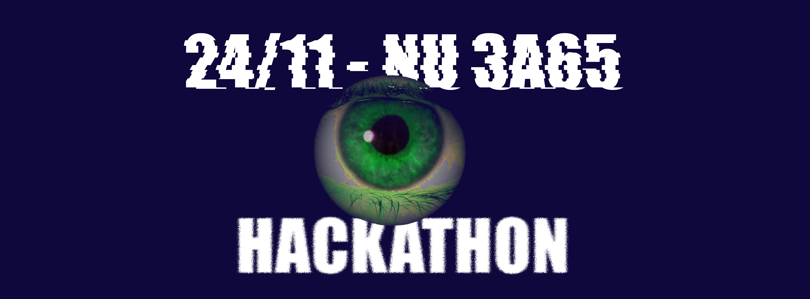

{height=300}

Theme: Hackathon, Security

[Level](../about.qmd): 2+

Bytes & Bites is hosting another hackathon! The 3 challenges come from a healthcare start up that is part of the VU start up community. Join us solo or in a team to work on one of the real business challenges in our 4 hour hackathon!

[Register](https://libcal.vu.nl/calendar/universitylibrary/Bytes_and_Bytes_Nov26_Hackathon)

Our guest, the founder of the start up has 3 security related challenges (don't worry you don't need a security background, just be aware that it's dealing with sensitive data). A full working solution is not needed, in fact a theoretical solution may be enough or a proof of concept in a language of your choice. 

In order to be viable as a winning solution you will need to keep your repository private and not share the code. The chosen solution(s) will have the opportunity to sign a paid deal with the company on their solution and continuing services. If you prefer to keep ownership of your code and share publicly then you can do so, but due to the nature of the challenge it won't be able to be used as a winning solution.

There will be pizza, snacks, drinks, stickers, and more!