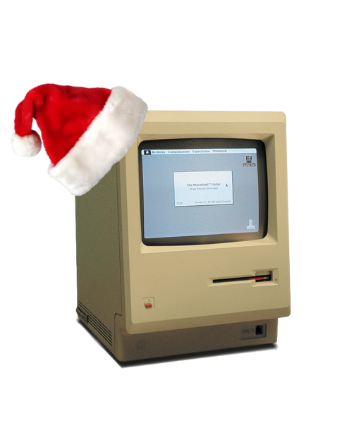

Theme: Advent of Code
[Level](../about.qmd): 2+

We are once more approaching the winter festivities and that means two things, every other evening is a borrel and the [advent of code](https://adventofcode.com/) has returned! To keep up with tradition we will work on the problems collectively and see if we can solve all 8 in our regular 2 hour session. No peeking at solutions before we try them!

Some festive snacks will be served this time around as well as the usual pizza!

[Register](https://libcal.vu.nl/calendar/universitylibrary/Bytes_and_Bites_Dec_2026)