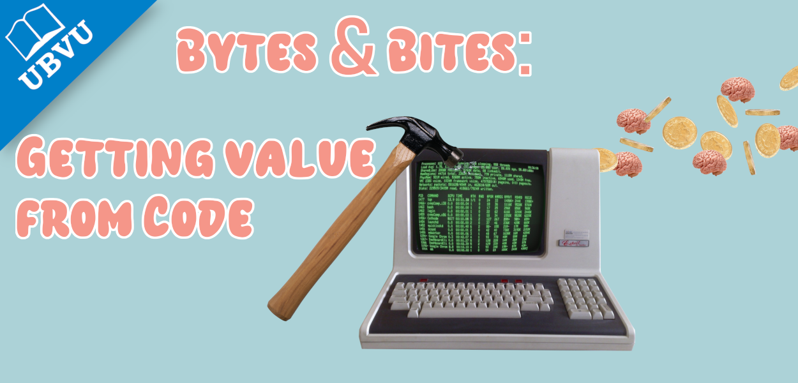

{height=220}

# Have you ever thought about how your software can become gold?

Well that is (sort of) what we heard about in the most recent Bytes & Bites session. Our three guest presenters told us about open science, starting a company at the VU, your rights as a creator, the path to entrepreneurship, and how the VU is uniquely positioned for valorisation.

## The communal experience of going solo
Bram Bark of the [DLAB](https://www.demonstratorlab.nl/) kicked off the session informing us about the ethos of the DLAB. The advice began with failure and how (just like in academia) it can be framed as a good thing. If you fail you have an opportunity to learn along the way and now know one thing (or more) that won't work. In fact, the faster you fail the better because spending years and thousands of euros working on an idea that has no demand is a bigger waste than trying it out fast on a small scale and realising the potential was bigger in your head than in reality. 

The DLAB itself embodies a good level of community support matched with professionalism and problem solving. With over 70 start ups at any one time in the community there are plenty of people going through the same challenges that can help you out with your own development and are happy to chat and brainstorm. To find out more [check out the open day](https://www.demonstratorlab.nl/events/demonstrator-lab-open-house-november-2026) on the 26th of November!

## Open science, the gift that keeps giving
Following the business angle Lucy O'Shea presented about the benefits of gold of the mind, open science! Open science is the idea that scientific research is publicly funded and so the results should be public too. It means that research can be in open journals, data is published without paywalls, models are shared for free, and software is open source. This has the added bonus of having your portfolio ready to share with potential employers. Open science is part of the societal impact side of valorisation and making your work open means others can build upon it and science can progress faster, plus you can get more citations if your paper, data, and software can all be cited! 

Interestingly the legality of ownership of data and software created in VU projects is a little complicated and so the VU provides help on IP rights. For instance, publishing your work will typically mean you can no longer patent it! For students you might be better off asking your supervisor to ask the questions as the support does not extend to them, but your [faculty data steward](https://vu.nl/nl/medewerker/research-data-support/raadpleeg-je-data-steward) will often be happy to help out or find out for you. In general your best bet to avoid sticky legal situations is to apply a license from the beginning, and you can read more on [data licensing](https://rdm.vu.nl/topics/data-licensing.html) and [software licensing](https://rdm.vu.nl/topics/software-licensing.html) in the RDM handbook!

But can open source work along side business? Well, there are a lot of groups that think so and a lot of teams that follow that exact model. For instance [AStRAL](https://astral.sh/about) works now as part of the Codex arm of OpenAI but still develops free and opensource tooling. A typical model might be having licenses for companies and keeping it free for individual use or providing hosting services to cover the cost of development, but there are all sorts of ways to run a company alongside an open source project. Another big example is [scikit-learn](https://scikit-learn.org/stable/) which remains free whilst providing accompanying services and tools that are paid for, hear more about it on the podcast [Code for Thought](https://codeforthought.buzzsprout.com/1326658/episodes/19815414-en-from-research-to-startup-scikit-learn-and-probabl). 

  

> "_Start. Just start._"
>
> -- Founder, Dr. Mohammed Hawas

  

## Strong foundations, start ups in the VU
Dr Mohammed Hawas told us about his journey to starting a healthcare start up and how being a VU alumni made this easier. Confirming that the DLAB is a great atmosphere to build connections and companies Dr Hawas reminded us that there is only so far you can get on your own before you need feedback on your idea. Start ups are famously lean and fast changing and so you need to be prepared to adapt your ideas and respond to the real world demands and constraints. When asked what one bit of advice would you provide to the people in the room looking to start their own company he said "_Start._" Hawas encouraged people to just try and to learn on the way '_you're young enough to take the risks._'

Dr Hawas will be returning later this month and providing us with the three challenges for our hackathon. To find out more check out the [event page](https://ubvu.github.io/bytes-and-bites/events/26_11-November_24_startup_hackathon.html) and [sign up via libcal](https://libcal.vu.nl/calendar/universitylibrary/Bytes_and_Bytes_Nov26_Hackathon)!

# Further reading
[IXA-GO](https://vu.nl/en/about-vu/organisations/ixa-go) - support for valorisation in the VU.

[IP rights at the VU](https://vu.nl/en/about-vu/more-about/intellectual-property) - Learn more.

[VU entrepreneurship](https://vu.nl/en/about-vu/more-about/entrepreneurship-on-vu-campus) - Links to all the 
services related to starting a company whilst at the VU.

[FAIR software](https://fair-software.nl/about) - Good practice principles for open science in software.