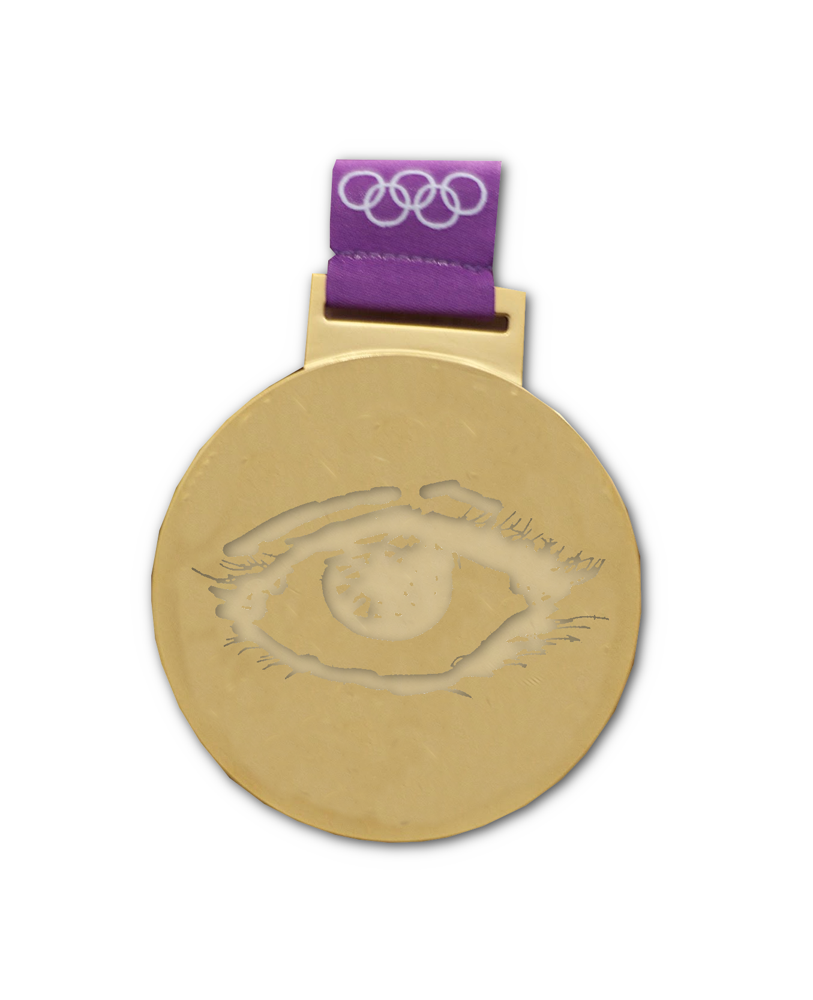

{height=250}

# We hope you all enjoyed yourselves!

The 2026 edition of the Bytes & Bites hackathon was on the 24th of November and we had a great turn out, the sign up list was maxed out and we had so much pizza it was delivered in the dominos bakfiets!

From the 44 attendees around half stayed to present their entry and there was quite a spectrum of solutions! In hindsight 4 and half hours is a long session and it running over by an additional hour didn't help things. In the future we will look to kick things off with a shorter session on a Thursday and have presentations and results on a Friday evening. 

# How it happened

The session began with an intro to the hackathon followed by an explanation of the healthcare field and the three problems, then it was on. There was energy in the air, a mixture of team sizes, a whole lot of ideas and even more questions. 

After playing around with the data and the app itself the real work began powered by cookies and soft drinks. Those with a keen eye will have spotted the treasure chest full of stickers amongst the kruidnoten and hopefully taken a handful. 

Around 6pm our 22 family size pizzas turned up and everyone had their fill (and more) before getting back to planning secure ways to work with sensitive data. And after another hour and 45 minutes we gathered for each entry to present their work. Out of the 44 participants 10 groups remained to present their solutions and everyone had at least one unique selling point making it tough to decide what the best three proposals were. 

After a lot of back and forth the three solutions were chosen and the entrants were provided with their certificates. Each winning team has been invited to further discussions on working with Dr Hawas in his company and can claim their library funded prize!

# Conclusion

We had a great turn out and a lot of interesting ideas and despite the eagerness, next time we could probably manage with slightly less pizza!

There was a lot we learned from our first two hackathons, but there is still a lot to improve. If you have any feedback or ideas please do email or [raise it as an issue](https://github.com/ubvu/bytes-and-bites/issues/new/choose) on the Bytes & Bites repository, until next time :)